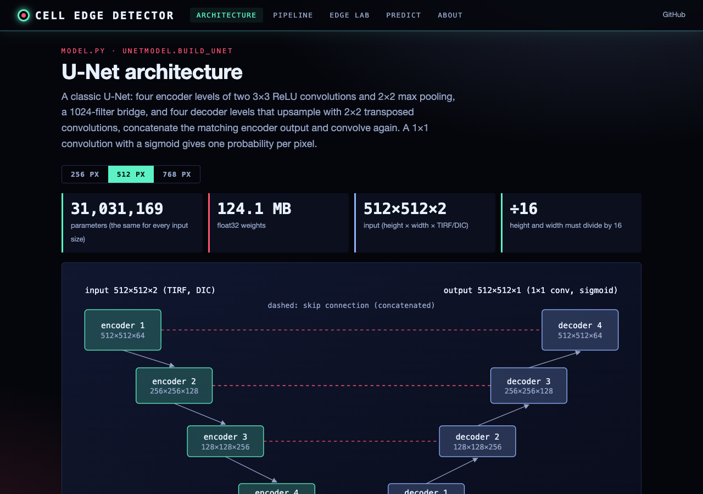
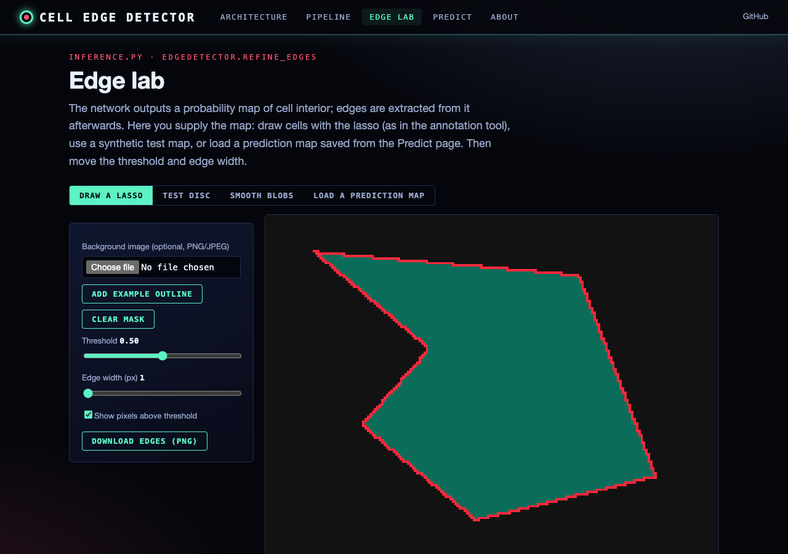
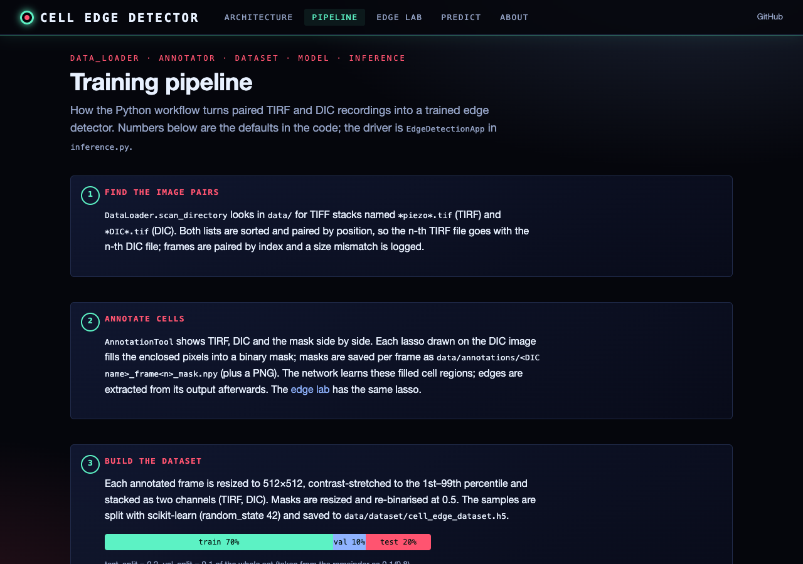

# Cell Edge Detection System

## Project Overview

The Cell Edge Detection System uses a U-Net architecture to detect cell edges in TIRF (Total Internal Reflection Fluorescence) and DIC (Differential Interference Contrast) microscopy images. The system allows you to:

1. Load and visualize TIRF and DIC image stacks
2. Annotate cell boundaries to create training data
3. Train a U-Net model to detect cell edges
4. Apply the trained model to new images
5. Visualize and export the detected cell edges

## Installation

### Prerequisites

- Python 3.7+
- TensorFlow 2.x
- OpenCV
- NumPy
- Matplotlib
- scikit-image
- h5py

### Setup

1. Clone or download the project code
2. Install the required dependencies:
   ```
   pip install -r requirements.txt
   ```
3. Place your TIRF and DIC microscopy images in the data directory

## Quick Start

### 1. Initialize the application

```python
from inference import EdgeDetectionApp

# Create and initialize the application
app = EdgeDetectionApp()
app.initialize()
```

### 2. Annotate images (create training data)

```python
# Start the annotation tool
app.annotate_images()
```

The annotation tool will open, allowing you to:
- View TIRF and DIC images
- Draw contours around cell boundaries using the lasso selection tool
- Save annotations
- Navigate between images

### 3. Train the model

```python
# Train the model using annotated data
history, output_dir = app.train_model(epochs=30)
```

The training will:
- Load annotated data and prepare the dataset
- Build and train the U-Net model
- Save the best model and training history
- Evaluate the model on test data

### 4. Process new images

```python
# Load a trained model (if not already loaded)
app.load_trained_model('models/unet_training_YYYYMMDD-HHMMSS/best_model.h5')

# Process a single image pair
prediction, edges, tirf_overlay, dic_overlay = app.process_image_pair(index=0, frame=0)

# Or process all images in batch mode
app.batch_process()
```

## Workflow Details

### Data Organization

The system expects your data to be organized as follows:
- TIRF images should contain "piezo" in the filename
- DIC images should contain "DIC" in the filename
- Both types should be TIFF stacks (multi-frame TIFFs)

### Annotation Process

1. Use the lasso tool to draw around cell boundaries
2. Click "Save Mask" to save the current annotation
3. Click "Clear Mask" to start over
4. Click "Next Image" to move to the next frame or image

### Model Training

The training process includes:
- Data augmentation (flips, rotations)
- Early stopping to prevent overfitting
- Model checkpointing to save the best model
- Learning rate reduction when performance plateaus

### Output

For each processed image, the system generates:
- Prediction maps (.npy files)
- Edge masks (.npy files)
- Visualization overlays (.png files)

## Advanced Usage

### Custom Model Parameters

```python
# Create model with custom parameters
model = UNetModel(input_shape=(768, 768, 2), n_classes=1)
app.model = model
```

### Edge Detection Customization

```python
# Adjust edge detection parameters
prediction, edges, _, _ = app.process_image_pair(
    index=0, 
    frame=0,
    threshold=0.7,  # Higher threshold for more confident predictions
    edge_width=2    # Thicker edges
)
```

### Batch Processing Options

```python
# Batch process with custom output directory and parameters
app.batch_process(
    output_dir='custom_results',
    threshold=0.6,
    edge_width=1
)
```

## Web interface

A local web app and a static site (GitHub Pages: https://gddickinson.github.io/cell_edge_detector/) show the
U-Net architecture layer by layer, the training pipeline with the code's defaults, and an **edge lab** where you draw
cell outlines (as in the annotation tool) or load a prediction map and extract edges with `refine_edges`. The repository
contains no trained weights and no microscopy data, so neither shows model predictions of its own; the local app's
**Predict** page runs a model you have trained (`models/**/best_model.h5`) on an uploaded TIRF/DIC pair.

```
pip install -r requirements-web.txt   # add tensorflow for the Predict page
python run_web.py                     # http://127.0.0.1:8147
python -m pytest -q tests             # includes tests/test_web.py and the JS engine's node test
python scripts/build_static.py        # static site in site/ (published by .github/workflows/pages.yml)
```

On the static site the edge lab runs a JavaScript port (`web/static/edge_engine.js`) of `refine_edges`, the lasso
fill and the percentile stretch, checked against the Python output by `web/static/edge_engine.test.mjs`; in the local
app the lab also runs the Python function and reports that the two agree.

| Architecture | Edge lab | Pipeline |
|---|---|---|
|  |  |  |

## Troubleshooting

- **GPU Memory Issues**: Reduce batch size or input dimensions
- **No Images Found**: Check naming conventions and directory structure
- **Poor Edge Detection**: Try increasing the number of annotations or adjusting thresholds

## Next Steps

- Experiment with different model architectures
- Implement additional post-processing techniques
- Add time series analysis for dynamic cell movements


---
*Built with AI assistance from [Claude (Anthropic)](https://claude.com/).*
